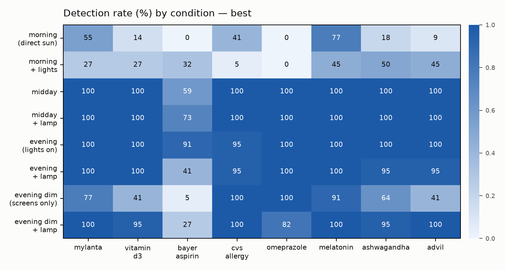
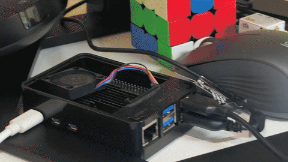
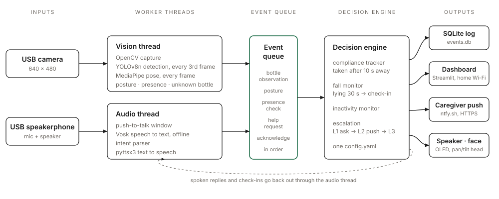

# MeSA 2.0 — Medication & Safety Assistant Robot

A tabletop assistive robot (Raspberry Pi 5, one webcam, ~$150) that helps an at-risk
person stay safe and on schedule with medication: it recognizes medication containers,
logs doses, watches for falls, answers voice questions, and escalates to a caregiver
when something's wrong. Built solo in a 10-week summer sprint — and then turned into a
research instrument that measured the limits of its own vision.

> ⚠️ **Assistive aid, not a medical device.** Fall detection is tested only with staged
> poses on cushions and must not be relied on for real emergencies.

## Research Overview

Can an AI system that performs exceptionally well in laboratory tests still make
dangerous mistakes in the real world?

MeSA (Medication & Safety Assistant) began as a low-cost, Raspberry Pi–powered robot
designed to recognize medication containers, track medication routines, and alert
caregivers (an assistive aid, not a medical device). During development, its creator,
Vrishaank Mishra, discovered that highly accurate AI models could become unreliable
under ordinary household conditions.

This observation inspired an investigation into **domain shift** — how AI performance
changes when real-world environments differ from training conditions.

Vrishaank developed a voice-guided evaluation protocol that generates expected labels
through controlled object placement, eliminating manual frame-by-frame annotation. He
compared three AI models across eight lighting conditions and two rooms, producing 8,910
automatically labeled frame–model evaluations.

Although the models achieved approximately 95–98% validation mAP@50, real-world
recognition differed by up to 44 percentage points between models under individual
conditions. The central finding is that **excellent benchmark scores do not guarantee
reliable or safe real-world performance** — which is why affordable assistive-vision
systems must be evaluated across the environments in which they actually operate.

## Key Research Contributions

<!-- DRAFT — factual bullets drawn from the work; reword in your own voice before this is final. -->

- A **self-administered evaluation method**: the robot speaks each scripted bottle
  placement and logs every frame, so every image is ground-truthed by construction —
  8,910 labeled evaluations with zero manual annotation.
- Direct evidence that **validation accuracy does not predict deployment**: three models
  inside a 0.95–0.98 validation band diverged by up to 44 points in the field.
- A characterization of **non-monotonic lighting failure**: direct morning sun is worse
  than near-darkness, and which containers fail inverts with their reflectance.
- An **open-set safety asymmetry**: wrong-medication rejection degrades as lighting
  improves, and no single confidence threshold serves every condition.
- A **cost-asymmetry result**: a $10 lamp did more for dim-light recognition than tripling
  the training data, and synthetic augmentation proved environment-dependent.
- **Two-site external validity**: the failure pattern and the lamp lift replicate in a
  second room (Spearman 0.80).
- All of the above on **$150 hardware, built and measured solo**, with every data point
  generated in-house.

## Experimental Results

- **Sunlight failure:** recognition fell to ~27% under direct morning sunlight.
- **Safety paradox:** known-medication recognition reached ~95% at midday, yet an
  unfamiliar look-alike was correctly rejected only 18% of the time — and no single
  confidence threshold performed reliably across every condition.
- **Practical mitigation:** a $10 LED lamp improved dim-light recognition from 65% to 88%
  in the first room (a 23-point gain), and the same lift replicated in the second room
  (+11 points).
- **Cross-room domain shift:** under corresponding midday conditions, recognition at the
  far placement mark dropped from 91% to 51% in the second room; even so, both rooms
  showed similar rankings of difficult conditions (Spearman 0.80 across four matched
  conditions).
- **Model generalization:** synthetic lighting augmentation performed poorly in the
  original room but outperformed the other models in three of four matched conditions in
  the second room — training interventions do not necessarily transfer between environments.



*Method: 1,584 scripted single-medication placements across an 8-condition lighting grid
at the first site, each scored against three model arms (4,752 evaluations), plus 1,512
frames across the same arms in a second room — zero manual annotation, ~90 minutes of
operator time per site.*

## Research Paper & Figures

- **Paper:** [docs/paper/domain-shift-paper.md](docs/paper/domain-shift-paper.md) — the full study.
- **Data:** [docs/eval/domain_shift_results.csv](docs/eval/domain_shift_results.csv) (site A) ·
  [docs/eval/domain_shift_results_family_room.csv](docs/eval/domain_shift_results_family_room.csv) (site B).
- **Cross-site statistics:** [docs/eval/site_stats.md](docs/eval/site_stats.md) (Wilson and
  Newcombe intervals, Spearman) · per-cell caveats: [docs/eval/site_notes.md](docs/eval/site_notes.md).
- **Figures:** [docs/eval/figures/](docs/eval/figures) · two-site comparison:
  [docs/eval/figures/two_site/](docs/eval/figures/two_site).
- **The day-by-day build log** (including everything that broke):
  [docs/engineering-notebook.md](docs/engineering-notebook.md).

## Robot Features

| Demo | Status |
|------|--------|
| **MED** — recognize 8 medications, flag unknowns as "wrong medication" | ✅ live-verified (first training round: held-out test mAP@50 **0.953**; all three arms 0.95–0.98 on validation) |
| **LOG** — bottle absent ≥10 s then returned → timestamped `taken` event → dashboard | ✅ live-verified on the Pi |
| **FALL** — standing/sitting/lying; sustained lying → spoken check-in | ✅ live-verified (incl. lying-detection fallback chain) |
| **VOICE** — offline: next med, did-I-take, call-for-help, date/time, "I'm okay" | ✅ live-verified |
| **ESCALATE** — L1 spoken check-in → L2 push (ntfy) → L3 caregiver alert | ✅ live-verified (unanswered check-in → L2 at 60 s, L3 at 120 s, both received on a phone) |
| *(Stretch)* pan-tilt head tracking, OLED emotions | coded + unit-tested; on-Pi verification pending |



*Full 90-second silent walkthrough of the rig (Pi 5, camera mount, marked medication
station, LED lamp, speakerphone): [setup tour video](https://github.com/VrishaankMishra/mesa-ai-robot/releases/tag/setup-tour-v1).*

## Architecture

One process, one event queue. Vision and audio workers publish events; the decision
engine consumes them and drives compliance, fall, and escalation logic.



```
mesa/
├── vision/      detector.py (YOLO + unknown-med logic), pose_estimator.py (MediaPipe
│                + lying fallback chain), posture.py, worker.py (live camera thread)
├── audio/       intents.py, assistant.py, stt.py (swappable), tts.py, worker.py
├── engine/      presence.py, compliance.py, escalation.py, inactivity.py,
│                events.py (EventBus), decision.py, schedule_gen.py
├── data/        database.py (SQLite)
├── hardware/    tracking.py, servos.py, oled.py, emotions.py (Pi-only plug modules)
├── research/    buffer.py, features.py, clip_io.py (pre-event capture layer)
└── dashboard/   app.py (Streamlit)
scripts/   setup_env, capture, capture_guided, detect_live, pose_live, voice_loop,
           eval_capture, eval_analyze, eval_figures, benchmark, soak_test, …
docs/      engineering-notebook.md (the day-by-day story) · eval/ (results + figures)
           paper/ (drafts + PDFs) · demo-runbook.md · domain-shift-sessions.md
           IMPLEMENTATION.md (ticket board) · capture-protocol.md · hardware-build.md
deploy/    mesa.service, install_pi.sh
```

## Reproducibility & Setup

Works on Intel macOS, Apple Silicon, and Linux. Requires **Python 3.11 or 3.12** —
*not 3.13* (the pinned mediapipe has no 3.13 wheel); the setup script enforces this:

```bash
bash scripts/setup_env.sh           # creates .venv, installs the stack, verifies imports
.venv/bin/python -m pytest          # all tests green (200+)
.venv/bin/python main.py --demo     # synthetic event sequence end-to-end
```

Running for real:

| What | Command | Needs |
|------|---------|-------|
| **Everything live** | `python main.py --live` | camera (+ mic, + `models/best.pt`) |
| Live detection only | `python scripts/detect_live.py` | camera + `models/best.pt` |
| Live posture/fall | `python scripts/pose_live.py --headless` | camera |
| Voice loop | `python scripts/voice_loop.py` | mic/speaker + Vosk model |
| Dashboard | `bash scripts/run_dashboard.sh` | — (LAN at `:8501`) |
| Dataset capture (Pi, voice-guided) | `python scripts/capture_guided.py --bottles … --lighting …` | camera + speaker |
| **Domain-shift eval session** | `python scripts/eval_capture.py --site <room> --condition …` | camera + speaker |
| Score eval sessions (all sites) | `python scripts/eval_analyze.py --models …` | eval_data + weights |
| Scene luminance per session | `python scripts/eval_luminance.py` | eval_data |
| Statistics pass + site replication | `python scripts/eval_stats.py` | results CSV |
| Regenerate study figures | `python scripts/eval_figures.py [--site <room>]` | results CSV |

Config (thresholds, model paths, ntfy topic) lives in [`config.yaml`](config.yaml).
Weights and images are gitignored — see [`models/README.md`](models/README.md) and
[`datasets/README.md`](datasets/README.md) for the real inventory.

**Tech:** Python 3.11/3.12 · OpenCV · Ultralytics YOLOv8 · MediaPipe · Vosk · pyttsx3 ·
SQLite · Streamlit · ntfy.sh · gpiozero / Adafruit CircuitPython (PCA9685, SSD1306) · pytest.
